# HouseholdManagement
家政服务人员技能评级系统
所有源码均本人开发，项目是前后端分离的，所有的项目都具备了完整的业务逻辑，不仅仅局限于基础的增删改查（CRUD）操作，系统亮点众多。

本文注重于计算机毕业设计选题指导，列出题目均有源码， 大家可以去【公众号】(毕业终点站)获取或者加我【qq】(2112698948)提意见(别忘记Star哟)。备注：git

声明：仅用于学习使用，请勿用于任何商业行为！

1.系统非商用，非开源，非无偿。

2.由本人开发，如需源码，请联系以下方式，qq:2112698948。

3.项目有很多，并未全部上传，如果未找到想要的，可直接咨询。
# 家政服务人员技能评级系统

> 三角色家政服务平台 + 一套可配置的技能评级算法：T-Score 标准化、时间衰减评价融合、百分位归一化、多维加权定级。

## 一、系统介绍

一套面向家政平台的人员评级系统，分管理员、普通用户、服务人员三个角色。用户挑人下单付钱，服务人员接单履约收钱，管理员管考核、算评级、审资质、看数据。

评级这件事是这套系统的重点。原始考核分不能直接比——不同考核项目难度不同，均值标准差都不一样，所以先做 T-Score 转换，把分数拉到同一把尺子上;服务质量不取简单平均，用时间衰减加权和中位数融合，近期的评价权重大，偶发的一两个差评也不会把整体拉垮;订单量、完成率、好评率这类业务数据跨度大，用 P5/P95 分位区间做 Min-Max，把极端值卡在边界内;最后四项按可配置的权重合成综合分，再按等级规则定级。资质加分单独算，单项有贡献上限，避免证书堆出一份虚高的评级。

### 系统亮点

**① T-Score 成绩标准化**
用考核项目的均值和标准差把原始分转成标准分（50 + 10Z），不同项目、不同批次的分能放在一起比，标准分同时用于展示和排名。

**② 服务质量评价算法**
综合总评分、服务态度、服务质量、准时性四项，先按时间衰减加权（越近的评价权重越高），再与中位数融合，既看近期状态，也不被个别极端评价带偏。

**③ 百分位 Min-Max 标准化**
订单量、订单完成率、好评率按 P5/P95 分位区间做归一化，超出区间的值直接钳到 0 或 1。业务数据里常见的那种一个超级大单拉高全平台均值的坑，这一层就挡掉了。

**④ 多维加权综合评级**
硬技能、服务质量、业务数据、附加资质四项得分按权重合成，权重可自定义（页面上能配几套方案，比如"服务质量优先""技能优先""默认"），评级周期和等级规则同样可配，计算完批量发布，人员等级和综合分同步更新。

**⑤ 资质加分与上限控制**
职业证书、荣誉奖项挂到加分规则上，计算时同时看审核状态、生效范围和单项贡献上限，只算审核通过的、在有效期内的，单项最多加多少也有封顶。评级结果保留完整计算明细，谁加了几分能追。

**⑥ 家政服务全流程**
浏览人员 → 选人下单 → 余额支付 → 服务人员接单 → 开始服务 → 完成服务 → 用户评价 → 收入结算，中间串着平台服务费、订单退款和提现审核。

**⑦ ECharts 统计分析**
订单、评价、考核三块共 25 张图表：状态分布、月度趋势、服务类型分布、人员订单排行、金额区间、每日接单趋势、项目通过率、成绩变化，都能在页面上直接看。

### 技术选型

| 层次 | 技术 |
| --- | --- |
| 架构 | B/S、MVC、前后端分离、三角色权限管理 |
| 后端 | Java 17、Spring Boot 3、Spring MVC、MyBatis-Plus、JWT |
| 数据库 | MySQL |
| 前端 | Vue 3、Vite、Element Plus、Vue Router、Pinia、Axios |
| 图表 | ECharts |
| 算法 | T-Score 标准化、时间衰减加权 + 中位数融合、百分位 Min-Max、多维加权合成 |

## 二、角色与功能

| 角色 | 主要功能 |
| --- | --- |
| 管理员 | 账号与登录日志、人员资料维护与审核、服务类型管理、服务订单与评价管理、证书奖项审核、考核项目与成绩录入、等级规则/加分规则/权重配置/评级周期、批量计算并发布评级、充值提现与交易流水、统计分析 |
| 普通用户 | 注册登录与资料维护、浏览六类家政服务（保洁/月嫂/育婴/老人陪护/烹饪/住家）、筛选人员看等级证书与评价、预约下单与余额支付、订单查询取消确认、服务评价、钱包充值提现 |
| 服务人员 | 证书与荣誉提交、考核成绩查询与申诉、接单/开始服务/完成服务、服务案例维护、查看评价、钱包与收入、提现申请 |

## 三、系统截图

### 登录入口

登录时先选身份（管理员 / 普通用户 / 服务人员），三个角色进的是三套不同的工作台。

### 普通用户端

#### 首页

服务分类入口、推荐服务人员和平台数据摆在一起，进来就能按需求挑服务类型。

#### 服务人员

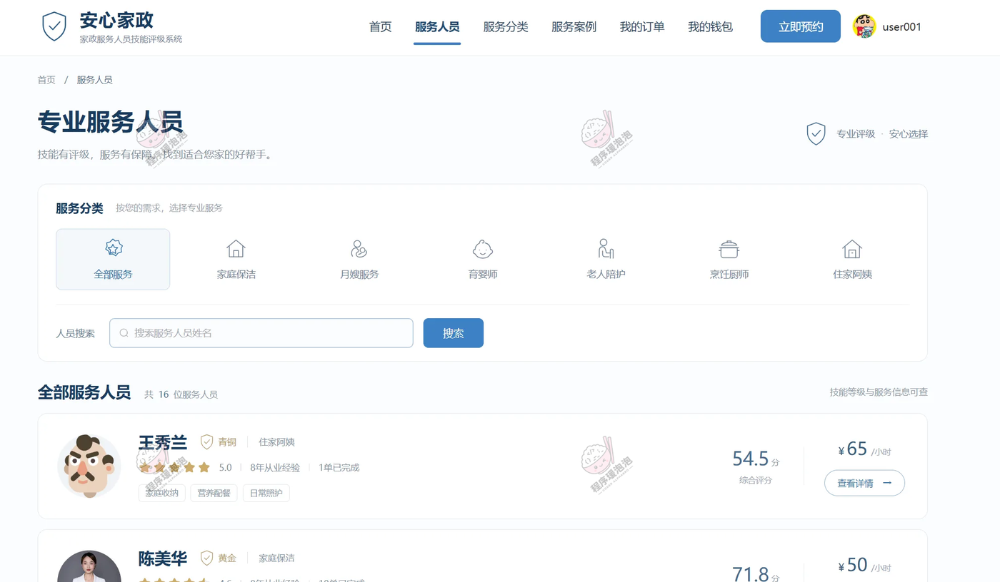

按服务类型、等级、价格筛选，卡片上直接显示综合分、等级、服务次数和好评率。

#### 服务详情

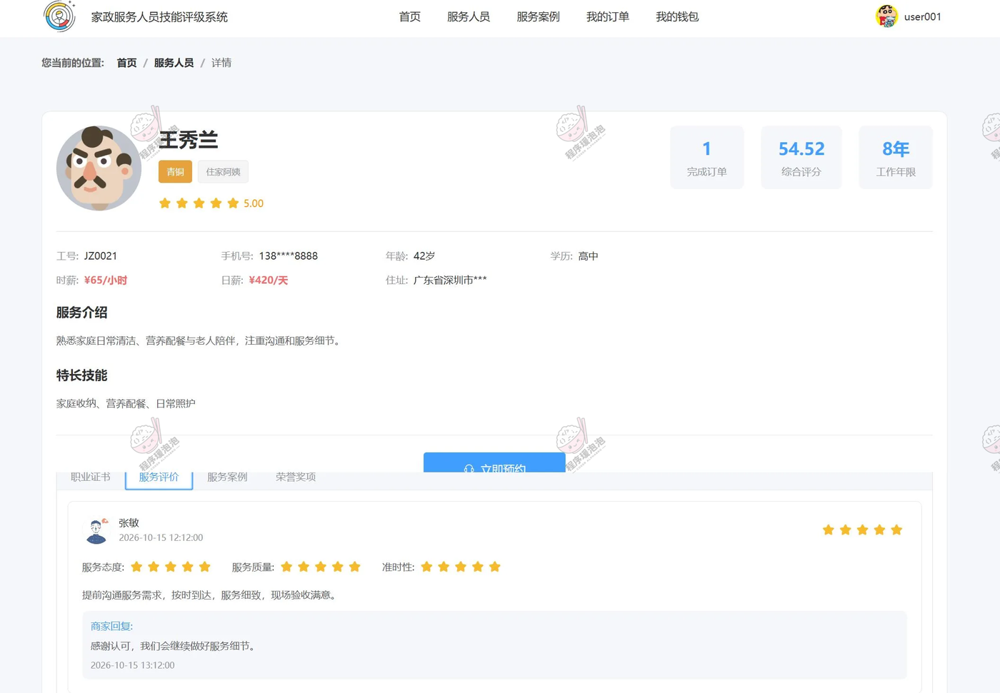

个人资料、技能等级、证书荣誉、服务案例和历史评价集中在一页，右侧直接选时间下预约单。

#### 服务案例

服务人员上传的真实服务记录，带图片和描述，比纯文字介绍有说服力。

#### 我的订单

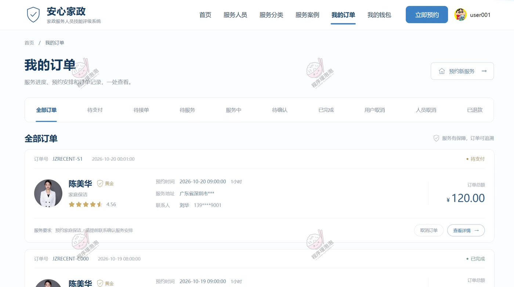

按状态筛订单，待支付、待服务、服务中、已完成、已取消分开看，详情里能取消、确认完成和评价。

#### 我的钱包

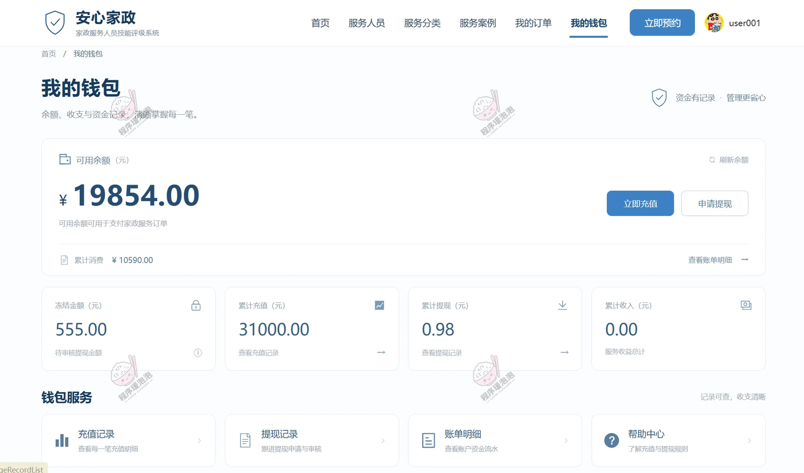

余额、充值、提现三个入口，下面挂充值记录、提现进度和交易流水。

### 服务人员端

#### 我的钱包

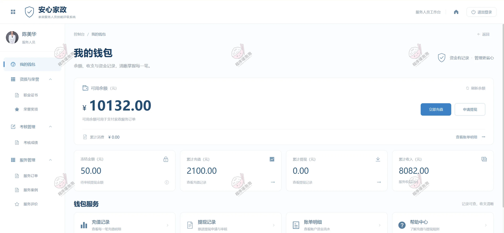

服务收入和平台结算分开显示，可提现金额、累计收入、待结算金额分三项列出。

#### 职业证书

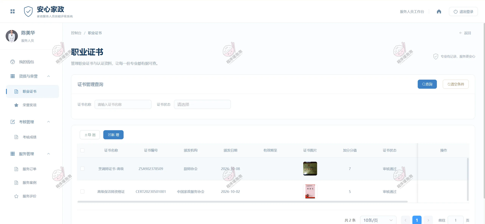

上传证书图片和编号，提交后等管理员审核，列表里能看到审核状态和驳回原因。

#### 荣誉奖项

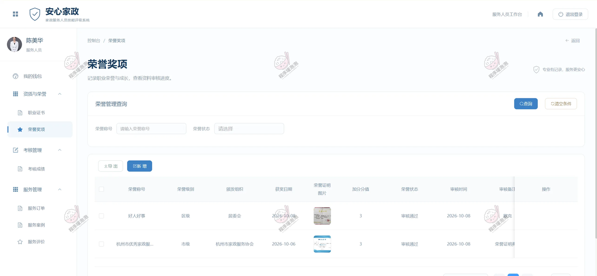

获奖记录同样走审核，审核通过后按加分规则计入资质得分。

#### 考核成绩

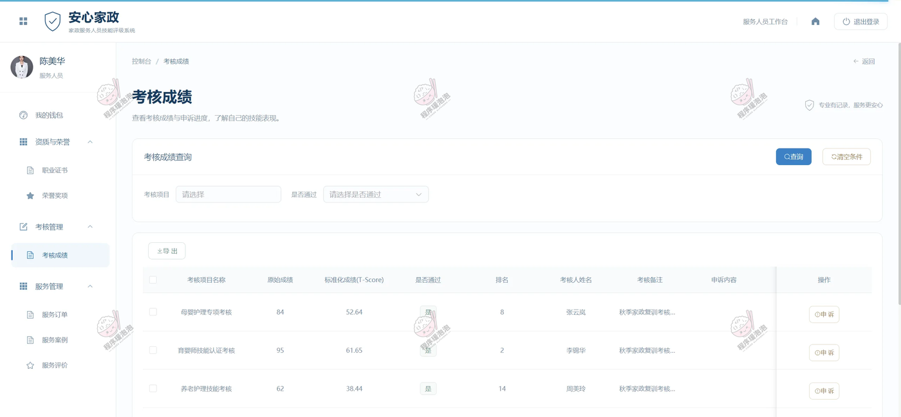

按考核项目看原始分、标准分和排名，对成绩有异议可以在这一页提交申诉。

#### 服务订单

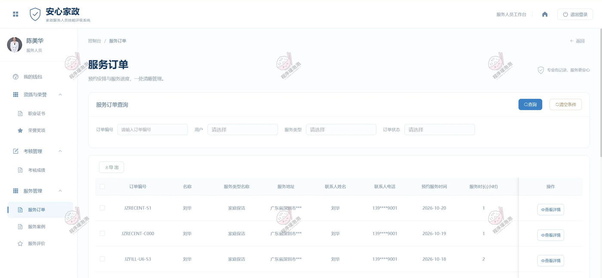

待接单、服务中、已完成分栏，接单后点开始服务，服务结束点完成，状态流转都在这一页。

#### 服务案例

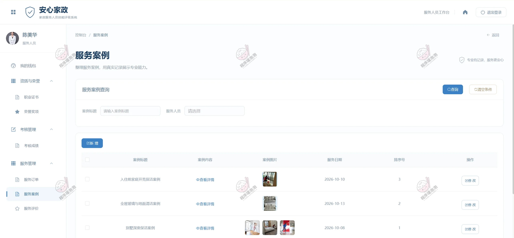

自己维护服务案例，传图写描述，发布后在用户端的详情页展示。

#### 服务评价

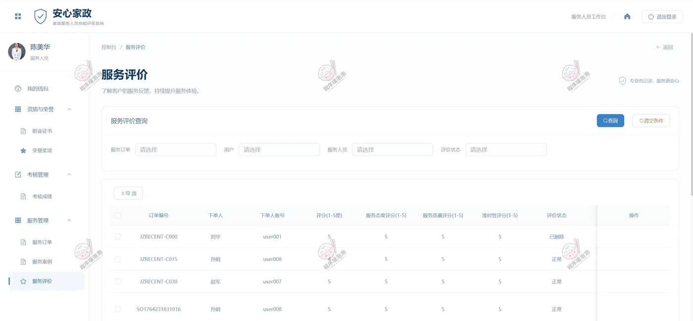

收到的评价按总评分、态度、质量、准时性拆开看，也是服务质量算法取数的来源。

### 管理员端

#### 服务订单

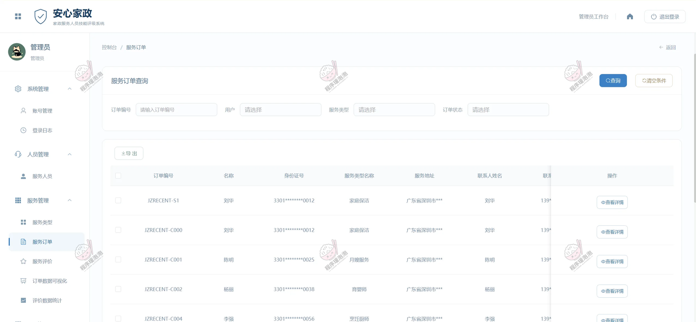

全平台订单查询，按服务人员、用户、状态、时间段筛，可查看详情、处理退款。

#### 服务评价

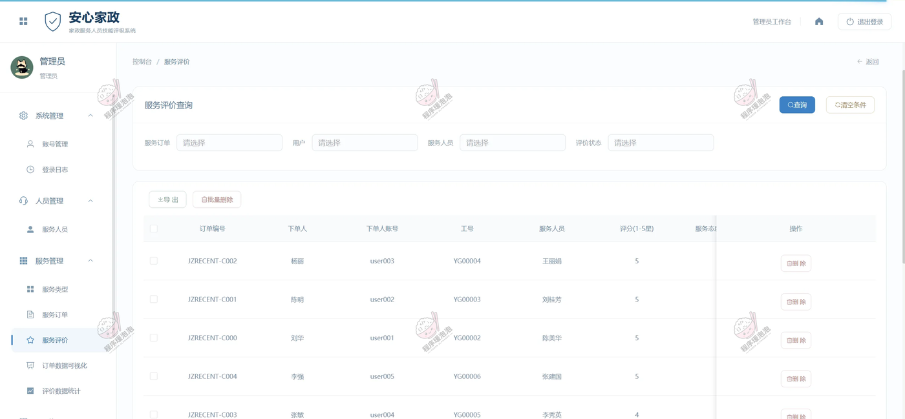

评价列表带四项细分评分，异常评价可以处理，数据同步进服务质量计算。

#### 订单数据可视化

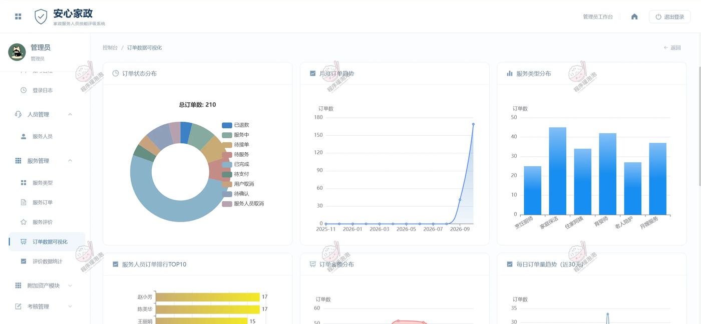

六块图表：订单状态分布环图、月度订单趋势、服务类型分布、服务人员订单排行 TOP10、订单金额区间、近 30 天每日接单趋势。

#### 职业证书

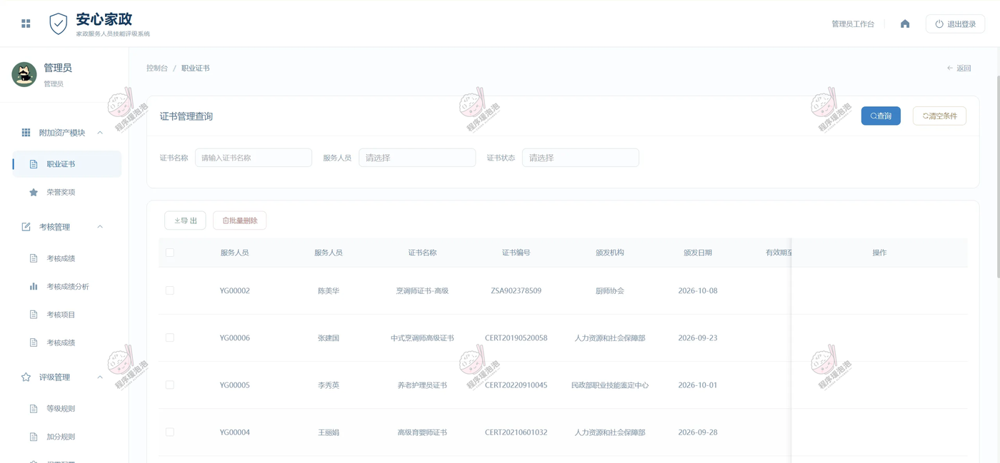

待审证书集中处理，通过后自动进入资质加分范围，驳回要填原因。

#### 考核成绩

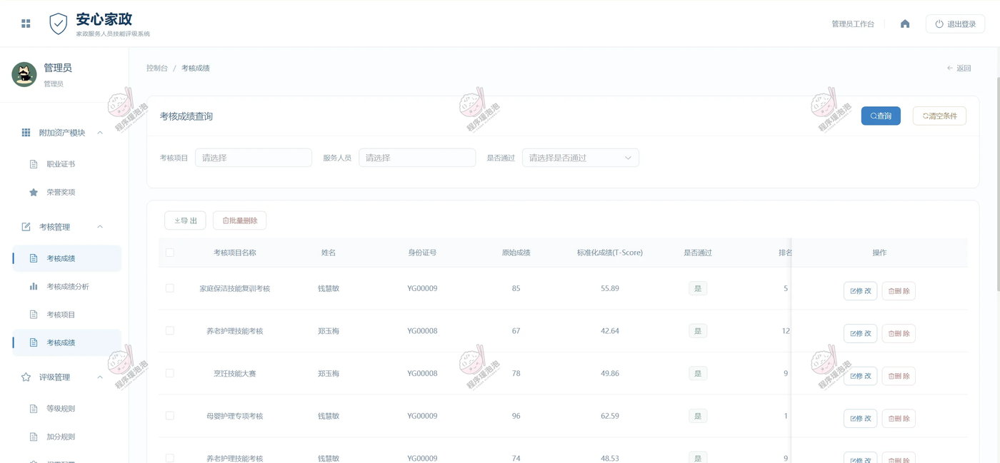

按考核项目批量录入成绩，系统算出标准分和排名，同时处理服务人员提交的申诉。

#### 加分规则

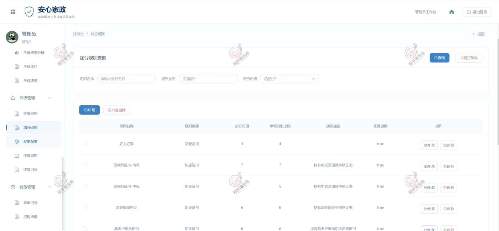

证书类型、奖项级别对应不同加分值，单项贡献上限在这里设，超上限按上限算。

#### 权重配置

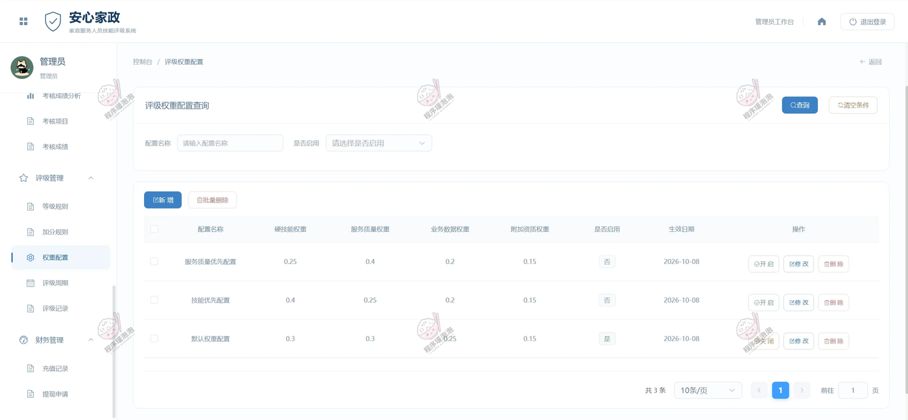

四维权重可配多套方案，比如「服务质量优先 0.25/0.4/0.2/0.15」「技能优先 0.4/0.25/0.2/0.15」，启用哪套就按哪套算。

#### 评级周期

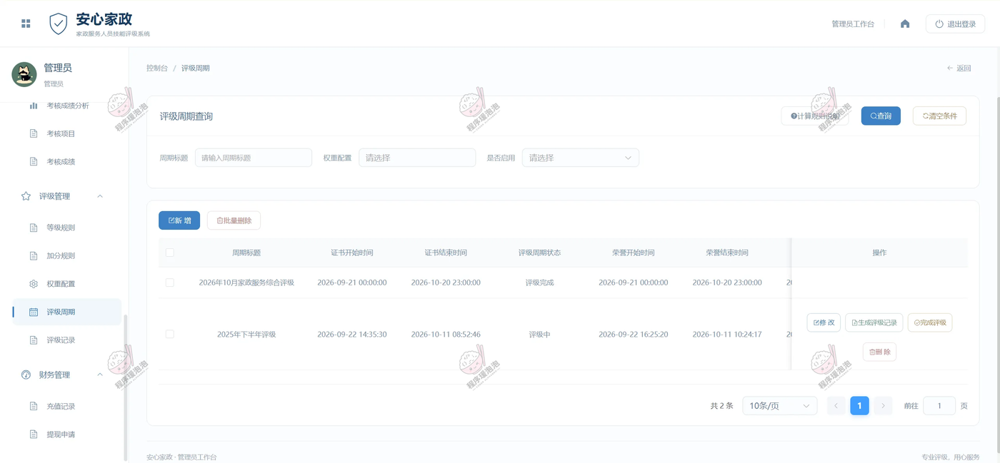

设置评级周期、等级区间和触发方式，到点批量计算，算完可以看每个人的得分明细再发布。

#### 提现申请

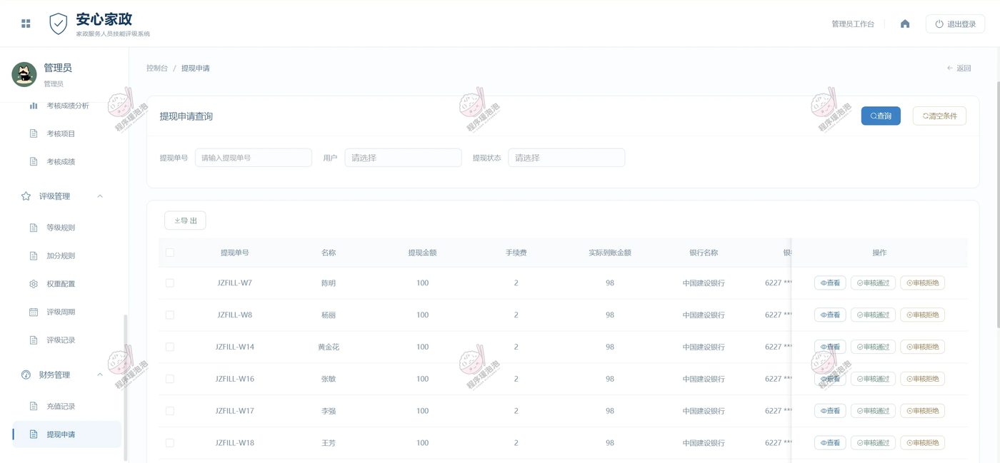

服务人员和用户的提现申请集中审核，通过后打款并生成转账凭证，全程留流水。

## 四、说明

- 文档展示 23 张截图，需要了解更多，请联系我。
- 系统为 B/S 三端（管理员 / 普通用户 / 服务人员），前后端分离，Windows + MySQL 本地部署即可运行。
- 评级相关参数（权重、等级区间、加分规则、周期）都在管理后台配置，不写死在代码里。

